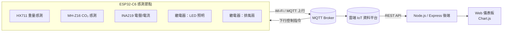

# SmartStall：IoT 智慧廁所監測與節能管理系統

> 2025 MCPC 參賽作品 — 以 ESP32-C6 感測節點結合 Web 儀表板，即時掌握廁所隔間的使用狀態、空氣品質與耗電，並提供人流預測、智慧清潔提醒與 ESG 節能報表。


---

## 📌 專案簡介

傳統公共廁所的照明與通風多半 24 小時全開，管理人員也難以得知哪間有人、哪間需要清潔。本專案在每個隔間安裝感測節點，透過**重量感測**判斷是否有人使用、以 **CO₂ 濃度**判斷空氣品質，並依此**自動控制照明與排風扇**，只在需要時才耗電。

感測資料經 MQTT 上傳至雲端平台，管理者可透過網頁儀表板即時查看各隔間狀態、歷史人流、清潔需求，以及系統帶來的節能減碳成效。

## ✨ 主要功能

**硬體端（自動控制）**

- **有人才開燈**：座位重量超過門檻時自動開燈；若持續佔用超過 5 分鐘則自動關燈，避免長時間浪費電力。
- **空氣品質連動通風**：CO₂ 濃度超過 1000 ppm 時自動開啟排風扇，降回標準後自動關閉。
- **耗電量量測**：以 INA219 量測電壓與電流，計算每個上傳週期的耗電量與累積耗電量。
- **遠端控制**：可透過 MQTT 下行指令手動開關，或設定定時開關燈光與風扇，並回傳 ACK 確認。

**Web 儀表板（管理端）**

- **即時隔間看板**：每 5 秒更新，以顏色標示「空閒 / 使用中 / 久佔」，並顯示使用時長與 CO₂ 濃度（良好 / 普通 / 不佳）。
- **人流分析與預測**：統計今日使用人次與尖峰時段，並以「昨日 30% + 上週同日 70%」加權，再乘上今日趨勢修正因子，預測未來各時段人流。
- **智慧清潔提醒**：計算自上次清潔後的使用人次，以進度條提示清潔需求；清潔完成後一鍵重置，紀錄會保存在伺服器端。
- **ESG 節能報表**：與「傳統 24 小時全開」比較，計算節省電力（Wh）、減少碳排（gCO₂e，係數 0.495 kgCO₂e/kWh）及節能率。

## 🏗️ 系統架構



## 📁 專案結構

```
2025-MCPC/
├── MCPC-Hardware/
│   ├── libraries/          # 使用到的 Arduino 函式庫（HX711、INA219、ArduinoJson 等）
│   └── main/
│       ├── main.ino        # 主程式：感測、上傳、自動與遠端控制
│       ├── config.h        # 腳位、MQTT 主題與上傳週期設定
│       └── include/        # PubSubClient、TinyGSM 等通訊函式庫
└── MCPC-WebApp/
    ├── server.js           # Express 後端：代理平台 API、清潔紀錄存取
    ├── index.html          # 儀表板頁面
    ├── script.js           # 前端邏輯：看板、預測、清潔、ESG 報表
    └── clean_status.json   # 各隔間最後清潔時間
```

## 🔧 硬體配置

| 元件 | 用途 | 腳位 |
| --- | --- | --- |
| ESP32-C6 | 主控板、Wi-Fi 連線 | — |
| HX711 + 荷重元 | 偵測座位是否有人 | DOUT 22、SCK 23 |
| MH-Z16 | NDIR CO₂ 感測（UART） | RX 4、TX 5 |
| INA219 | 電壓 / 電流 / 耗電量測（I²C） | SDA 6、SCL 7 |
| 繼電器模組 | 控制排風扇 | GPIO 10 |
| 繼電器模組 | 控制 LED 照明 | GPIO 11 |

## 🚀 快速開始

### 1. 燒錄韌體

1. 安裝 [Arduino IDE](https://www.arduino.cc/en/software) 與 ESP32 開發板套件（Boards Manager 搜尋 `esp32`）。
2. 將 `MCPC-Hardware/libraries/` 內的函式庫複製到 Arduino 的 `libraries` 資料夾。
3. 開啟 `MCPC-Hardware/main/main.ino`，修改 Wi-Fi 名稱與密碼；需要時調整 `config.h` 內的 MQTT 與腳位設定。
4. 開發板選擇 **ESP32C6 Dev Module**，編譯並上傳。
5. 開啟序列埠監控視窗（115200 baud）確認連線與上傳狀況。

### 2. 啟動 Web 儀表板

```bash
cd MCPC-WebApp
npm install
node server.js
```

接著以瀏覽器開啟 <http://localhost:3000>。

> 平台帳號與各感測器 ID 分別設定於 `server.js` 與 `script.js` 的 `STALLS_CONFIG`；若要新增隔間，在 `STALLS_CONFIG` 加入一筆設定即可。

## 🔌 後端 API

| 方法 | 路徑 | 說明 |
| --- | --- | --- |
| GET | `/api/sensor-data?type=&id=` | 取得感測器最新狀態（使用狀態、使用時長或空氣品質） |
| GET | `/api/sensor-history?type=&id=` | 取得過去 24 小時歷史資料 |
| GET | `/api/sensor-history-7days?type=&id=` | 取得過去 7 天歷史資料（供人流預測） |
| GET | `/api/clean-status?stallName=` | 取得隔間最後清潔時間 |
| POST | `/api/clean-reset` | 重置隔間清潔狀態（body：`{ "stallName": "隔間 1" }`） |

## 📡 MQTT 資料格式

上行資料每 60 秒發送一次，格式為：

```json
[{ "macAddr": "<裝置 MAC>", "data": "<多組 Hex 編碼感測值>" }]
```

下行控制指令的 `data` 欄位：

| 類型 | 格式 | 範例 | 說明 |
| --- | --- | --- | --- |
| 手動控制 | `0F` + 腳位(2) + 開關(2) | `0F0B01` | 開啟 LED（GPIO 11） |
| 定時控制 | `1F` + 腳位(2) + 秒數(6) | `1F0A00003C` | 開啟風扇 60 秒後自動關閉 |

## 🛠️ 技術棧

- **韌體**：Arduino (C++)、ESP32-C6、PubSubClient、ArduinoJson、HX711、Adafruit INA219
- **通訊**：Wi-Fi、MQTT（程式中保留 SIM7020 NB-IoT 的實作可切換）
- **後端**：Node.js、Express、node-fetch
- **前端**：HTML / CSS / JavaScript、Chart.js

## 👥 團隊成員

| 姓名 | 負責項目 |
| --- | --- |
| 待填寫 | 待填寫 |
